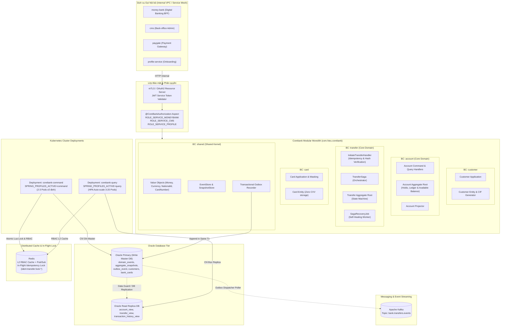
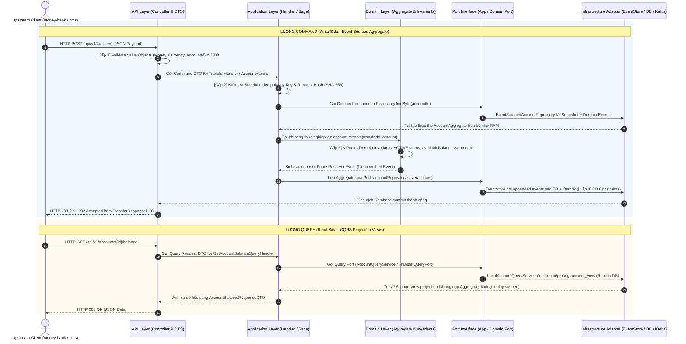
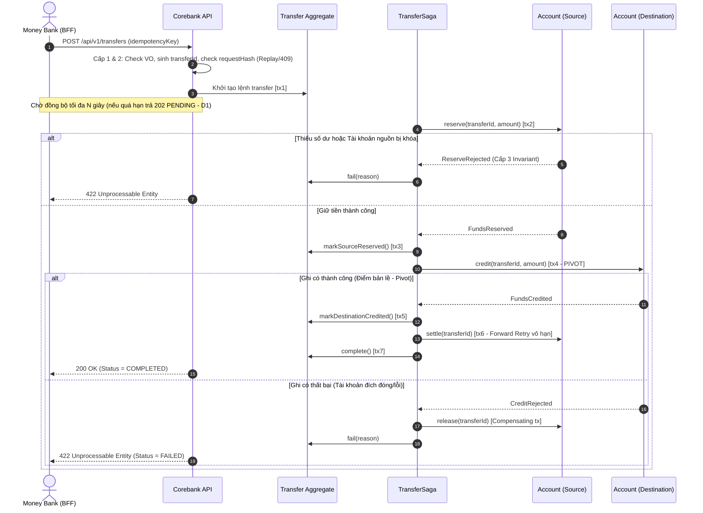
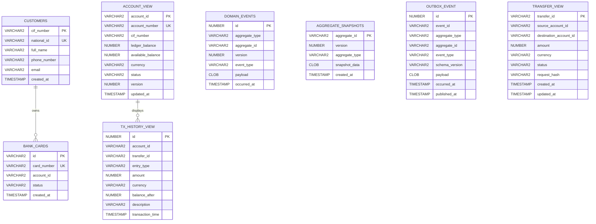

# High-Level Design (HLD) — Corebank Service
**Dự án:** Simulation Bank Platform  
**Phân hệ:** Sổ cái Ngân hàng Trung tâm (`corebank`)  
**Phiên bản:** 1.1.0  
**Ngày cập nhật:** 2026-10-10  
**Trạng thái:** Chính thức  
**Tham chiếu:** [`brd.md`](./brd.md) (v1.1.0), [`plan.md`](./plan.md) (v3), [`srd.md`](./srd.md).

---

## 1. Giới thiệu & Triết lý Thiết kế Kiến trúc

### 1.1. Mục đích Tài liệu
Tài liệu HLD (High-Level Design) này mô tả kiến trúc tổng thể của dịch vụ **Corebank** — trái tim sổ cái trung tâm (Single Source of Truth) trong hệ thống ngân hàng mô phỏng **Simulation Bank Platform**. Tài liệu làm cơ sở kỹ thuật chuẩn mực cho các kỹ sư phát triển, kiến trúc sư hệ thống, và đội ngũ DevOps/SRE hiểu rõ:
- Ranh giới nghiệp vụ (Bounded Contexts) và tính thuần khiết của Domain.
- Quy trình điều phối Saga và kiểm soát giao dịch phân tán.
- Cơ chế kiểm soát xử lý đồng thời (Concurrency Control) và Tự bảo vệ Sổ cái (Zero-Trust Idempotency).
- Mô hình phân tách vật lý CQRS trên hạ tầng Kubernetes.
- Các tiêu chuẩn tuân thủ an toàn dữ liệu ngân hàng (Nghị định 13/2023/NĐ-CP và Thông tư 13/2018/TT-NHNN).

### 1.2. Triết lý Thiết kế Cốt lõi
1. **Zero Data Loss & Sổ cái Kép Bất biến (Double-Entry General Ledger):**
   Mọi biến động số dư tài chính đều tuân thủ nguyên lý kế toán kép:
   $$\sum \text{Debit (Nợ)} = \sum \text{Credit (Có)}$$
   Dữ liệu sổ cái là chuỗi sự kiện bất biến (Append-Only), không bao giờ cập nhật ghi đè hay xóa bỏ.
2. **Domain-Driven Design (DDD) & Clean Architecture:**
   - Đặt nghiệp vụ tài chính làm trung tâm. Lớp `domain` giữ trạng thái thuần khiết 100%, độc lập hoàn toàn với Spring Framework, JPA/Hibernate, Jackson, hay các thư viện hạ tầng.
   - Phân định rạch ròi các Bounded Contexts. Giao tiếp liên-context chỉ qua Application Ports/APIs và Integration Events.
   - **Mỗi database transaction chỉ được phép cập nhật duy nhất 1 Aggregate Root.**
3. **Chiến lược Thẩm định Đa tầng (4-Level Validation Strategy):**
   Áp dụng mô hình thẩm định chiều sâu: *Value Object (In-Memory)* $\rightarrow$ *Use Case (Stateful/IO)* $\rightarrow$ *Aggregate Invariant (Business Rules)* $\rightarrow$ *Database Constraint (Concurrency Safety Net)*.
4. **Saga Orchestration & Nhất quán Cuối cùng (Eventual Consistency):**
   Chuyển tiền liên-aggregate thông qua điều phối Saga 2 pha có điểm bản lề (Pivot Transaction), tự động bù trừ (Compensating Transaction) và tự phục hồi sau sự cố (`SagaRecoveryJob`).
5. **Tự bảo vệ Sổ cái (Zero-Trust Idempotency):**
   Corebank không dựa dẫm vào tầng BFF (`money-bank`); tự chịu trách nhiệm phát hiện trùng lặp và xung đột thông qua mã giao dịch tất định $\text{UUID v3}$ và mã băm SHA-256 payload.
6. **CQRS Phân tách Vật lý trên K8s (Physical Infrastructure CQRS):**
   Phân tách hoàn toàn cụm Pod Ghi (`corebank-command`) kết nối Primary Write Master DB và cụm Pod Đọc (`corebank-query`) kết nối Read Replica DB, auto-scale độc lập qua HPA.
7. **Bảo vệ Dữ liệu Cá nhân Nhạy cảm (Privacy & Compliance):**
   Tuân thủ Nghị định 13/2023/NĐ-CP: Che mờ dữ liệu (Data Masking cho CCCD, số thẻ PAN), cấm lưu trữ plaintext và cấm phơi bày mã bí mật CVV/PIN, loại bỏ hoàn toàn việc in dữ liệu nhạy cảm ra log file/MDC.

---

## 2. Bức tranh Kiến trúc Tổng thể (System Architecture)



---

## 3. Kiến trúc Phân tầng Clean Architecture & Domain-Driven Design (CA & DDD)

Dịch vụ Corebank được xây dựng trên sự kết hợp chặt chẽ giữa **Clean Architecture (Onion / Hexagonal Architecture)** và **Domain-Driven Design (DDD)** theo triết lý của Eric Evans, Martin Fowler và Khalil Stemmler. Kiến trúc này tách biệt triệt để logic nghiệp vụ tài chính khỏi hạ tầng kỹ thuật, đảm bảo sổ cái có tính ổn định, dễ kiểm thử, có thể mở rộng và sẵn sàng tách thành các Microservices độc lập.

```mermaid
flowchart TB
    subgraph PresentationLayer["1. TẦNG API / PRESENTATION (Inbound Interface Adapters)"]
        direction TB
        Controllers["REST Controllers (@RestController)<br/>CustomerController, AccountController, TransferController, CardController"]
        DTOs["Request / Response DTOs<br/>(Thẩm định dữ liệu đầu vào & Serialization)"]
        ExceptionHandlers["Global Exception Handler<br/>(ApiExceptionHandler: HTTP 400, 404, 409, 422, 500)"]
    end

    subgraph ApplicationLayer["2. TẦNG APPLICATION (Use Cases & Workflow Orchestration)"]
        direction TB
        subgraph UseCases["Command & Query Handlers"]
            CmdHandlers["Command Handlers<br/>(AccountHandler, TransferHandler, CustomerHandler, CardHandler)"]
            QueryHandlers["Query Handlers<br/>(GetAccountBalanceQueryHandler, GetAccountsByCifQueryHandler, ...)"]
            SagaOrch["Saga Orchestration & Self-Healing<br/>(TransferSaga, SagaRecoveryJob, SagaMetricsCollector)"]
        end
        subgraph Ports["Application Ports (Interfaces)"]
            InboundPorts["Inbound Ports: Use Case Handlers"]
            OutboundPorts["Outbound Ports: CustomerDirectory, AccountGateway, StuckTransferQueryPort"]
            EventPorts["Event Ports: DomainEventPublisher, IntegrationEventPublisher"]
        end
    end

    subgraph DomainLayer["3. TẦNG DOMAIN (Core Business Rules - 100% Pure POJO)"]
        direction TB
        Aggregates["Aggregate Roots (AggregateRoot&lt;ID&gt;)<br/>AccountAggregate (Holds, Balances), Transfer (State Machine)"]
        Entities["Entities & Local State<br/>Hold (Phong tỏa), Customer, BankCard"]
        ValueObjects["Value Objects (Immutable)<br/>Money, Currency, AccountId, AccountNumber, TransferId, NationalId, CardNumber"]
        DomainEvents["Domain Events (Sự kiện nghiệp vụ bất biến)<br/>AccountCreatedEvent, FundsReservedEvent, FundsCreditedEvent, ReservationSettledEvent"]
        DomainPorts["Domain Interfaces / Ports<br/>AccountRepository, TransferRepository, CustomerRepository, CardRepository, CifGenerator"]
        DomainExceptions["Domain Invariants & Exceptions<br/>DomainException, BusinessException, ConflictException, NotFoundException"]
    end

    subgraph InfrastructureLayer["4. TẦNG INFRASTRUCTURE (Outbound Adapters & Frameworks)"]
        direction TB
        subgraph PersistenceAdapters["Persistence Adapters (Data Storage)"]
            EventStoreAdapter["Event Store & Snapshot Store<br/>(EventStore&lt;T&gt;, SnapshotStore, EventSourcedAccountRepository)"]
            JpaAdapters["JPA Repositories & Entities<br/>(CustomerJpaRepository, CardJpaRepository, CustomerEntity, CardEntity)"]
        end
        subgraph Projections["CQRS Read Model Projections"]
            Projectors["Projectors: AccountProjector, TransferProjector"]
            ViewRepos["Projection Views: account_view, transfer_view, transaction_history_view"]
        end
        subgraph InterBcAdapters["Inter-BC Adapters (In-Process Gateways)"]
            GatewayAdapters["InProcessAccountGateway, LocalCustomerDirectory, LocalAccountDirectory"]
        end
        subgraph MessagingAdapters["Messaging & Integration Outbox"]
            OutboxAdapter["Transactional Outbox Recorder (outbox_event) & Kafka Publisher"]
        end
    end

    %% Chiều phụ thuộc Clean Architecture: Mọi mũi tên hướng vào trong tâm Domain
    PresentationLayer -->|1. Gọi Use Cases| ApplicationLayer
    ApplicationLayer -->|2. Thao tác Nghiệp vụ & Đổi trạng thái| DomainLayer
    InfrastructureLayer -.->|3. Hiện thực Outbound Ports (DIP)| ApplicationLayer
    InfrastructureLayer -.->|4. Hiện thực Domain Repository Ports (DIP)| DomainLayer
    InfrastructureLayer -->|5. Đọc & Ánh xạ Dữ liệu| DomainLayer
```

---

### 3.1. Đặc tả Chi tiết 4 Tầng Kiến trúc & Khối DDD (Building Blocks)

| Tầng Kiến trúc | Phạm vi & Trách nhiệm (Responsibilities) | Các Thành phần DDD & Kỹ thuật Cốt lõi | Chiều Phụ thuộc (Dependencies) |
|---|---|---|---|
| **1. API / Presentation** | Tiếp nhận HTTP Request từ upstream (BFF, CMS, Paygate), xác thực sơ bộ định dạng dữ liệu (Bean Validation `@Valid`), chuyển đổi Request DTO thành Command/Query, ủy thác cho tầng Application và trả về HTTP Response DTO chuẩn hóa (kèm che mờ dữ liệu nhạy cảm). | REST Controllers (`@RestController`), Request/Response DTOs, Serialization/Deserialization (Jackson 3), Exception Handler (`ApiExceptionHandler`). | Phụ thuộc vào **Application Layer** (DTOs & Handlers) và **Shared Domain** (Value Objects). Tuyệt đối không gọi trực tiếp Domain Aggregate hay Persistence. |
| **2. Application** | Hiện thực các Use Cases nghiệp vụ; điều phối luồng công việc (Workflow Orchestration); kiểm tra tính hợp lệ trạng thái (Stateful Validation - Cấp 2); điều phối giao dịch liên-aggregate (Saga); định nghĩa các Inbound/Outbound Ports; phát hành sự kiện tích hợp (Integration Events). | Command Handlers (`AccountHandler`, `TransferHandler`), Query Handlers (`GetAccountBalanceQueryHandler`), Saga Orchestrators (`TransferSaga`, `SagaRecoveryJob`), Application Ports (`AccountGateway`, `CustomerDirectory`, `TransferQueryPort`). | Phụ thuộc vào **Domain Layer** và **Shared Kernel**. Tuyệt đối **KHÔNG phụ thuộc** vào Infrastructure hay API Controllers (Tuân thủ ArchUnit Rule 2). |
| **3. Domain (Core)** | **"Trái tim" của hệ thống**: Nắm giữ toàn bộ quy tắc nghiệp vụ cốt lõi (Business Rules), phương trình kế toán kép, kiểm soát Invariants trên RAM (Cấp 3). Hoàn toàn **thuần khiết 100% POJO**, độc lập với mọi Framework. | Aggregate Roots (`AccountAggregate`, `Transfer`), Entities (`Hold`, `Customer`, `BankCard`), Value Objects (`Money`, `Currency`, `AccountId`, `NationalId`, `CardNumber`), Domain Events, Domain Exceptions, Domain Ports (`AccountRepository`, `CifGenerator`). | **Không phụ thuộc vào bất kỳ tầng nào khác** ngoài `shared.domain`. Không import Spring, JPA/Hibernate, Jackson, hay bất kỳ thư viện bên ngoài nào (Tuân thủ ArchUnit Rule 1). |
| **4. Infrastructure** | Hiện thực hóa các Outbound Ports và Domain Interfaces thông qua cơ chế Đảo ngược Phụ thuộc (Dependency Inversion Principle - DIP); chịu trách nhiệm lưu trữ sự kiện (Event Store), snapshot, JPA persistence, đẩy sự kiện ra Transactional Outbox, đồng bộ các bảng Read Projection (CQRS), và kết nối mạng nội bộ giữa các Bounded Context. | `EventStore<T>`, `SnapshotStore`, `EventSourcedAccountRepository`, `AccountProjector`, `TransferProjector`, JPA Repositories & Entities (`CustomerJpaRepository`), Adapters (`InProcessAccountGateway`, `LocalCustomerDirectory`), Kafka Outbox Dispatcher. | Phụ thuộc vào **Application Ports**, **Domain Layer**, và **Shared Kernel**. Hiện thực các interface do Application và Domain định nghĩa. |

---

### 3.2. Sơ đồ Luồng Tương tác Thực thi & Đảo ngược Phụ thuộc (DIP Request Flow)

Cơ chế Đảo ngược Phụ thuộc (Dependency Inversion Principle - DIP) đảm bảo tầng Domain và Application không bị trói buộc vào cơ sở dữ liệu hay hạ tầng công nghệ. Dưới đây là luồng xử lý chi tiết cho cả hai chiều **Command (Ghi qua Event Sourcing)** và **Query (Đọc qua CQRS Projections)**:



---

### 3.3. Ranh giới Bounded Contexts & Cơ chế Tích hợp Ports & Adapters

Hệ thống được tổ chức thành 5 Bounded Contexts nghiệp vụ và 1 Shared Kernel dùng chung theo mô hình **Modular Monolith**:

```mermaid
flowchart TD
    subgraph SharedKernel["Shared Kernel (com.hieu.corebank.shared)"]
        direction LR
        VOs["Value Objects Bất biến:<br/>Money, Currency, NationalId, CardNumber, TransferId, AccountId, AccountNumber, CustomerId"]
        BaseClasses["Lớp Nền tảng Thuần khiết:<br/>AggregateRoot&lt;ID&gt;, DomainEvent, DomainException, BusinessException"]
        SharedInfra["Hạ tầng Dùng chung:<br/>EventStore&lt;T&gt;, SnapshotStore, OutboxRecorder, ProfileConstants"]
    end

    subgraph TransferBC["Bounded Context: transfer (Core Subdomain)"]
        TransferAPI["transfer.api<br/>TransferController"]
        TransferApp["transfer.application<br/>TransferHandler, TransferSaga, SagaRecoveryJob"]
        TransferDomain["transfer.domain<br/>Transfer (Aggregate Root), TransferStatus"]
        TransferPort["transfer.application.port<br/>AccountGateway, TransferIdempotencyLockPort, TransferQueryPort"]
        TransferAdapter["transfer.infrastructure<br/>InProcessAccountGateway, RedisTransferIdempotencyLockAdapter, TransferQueryAdapter"]
    end

    subgraph AccountBC["Bounded Context: account (Core Subdomain)"]
        AccountAPI["account.api<br/>AccountController"]
        AccountApp["account.application<br/>AccountHandler, AccountQueryService"]
        AccountDomain["account.domain<br/>AccountAggregate (Aggregate Root), Hold (Entity)"]
        AccountPort["account.application.port<br/>CustomerDirectory (Outbound Port)"]
        AccountAdapter["account.infrastructure.customer<br/>LocalCustomerDirectory (Adapter)"]
        AccountProj["account.infrastructure.projection<br/>AccountProjector, account_view, tx_history_view"]
    end

    subgraph CustomerBC["Bounded Context: customer (Supporting Subdomain)"]
        CustomerAPI["customer.api<br/>CustomerController"]
        CustomerApp["customer.application<br/>CustomerHandler, GetCustomerQueryHandler"]
        CustomerDomain["customer.domain<br/>Customer Entity, CustomerRepository, CifGenerator"]
        CustomerAdapter["customer.infrastructure.persistence<br/>JpaCustomerRepositoryAdapter, CustomerJpaRepository"]
    end

    subgraph CardBC["Bounded Context: card (Supporting Subdomain)"]
        CardAPI["card.api<br/>CardController"]
        CardApp["card.application<br/>CardHandler, GetCardByIdQueryHandler"]
        CardDomain["card.domain<br/>BankCard Entity, CardRepository"]
        CardPort["card.application.port<br/>AccountDirectory (Outbound Port)"]
        CardAdapter["card.infrastructure.account<br/>LocalAccountDirectory (Adapter)"]
        CardJPA["card.infrastructure.persistence<br/>JpaCardRepositoryAdapter, CardJpaRepository"]
    end

    subgraph AccessBC["Bounded Context: access (Generic Subdomain)"]
        AccessSecurity["access.security<br/>@CoreBankAuthorization, CoreBankAuthorizationAspect, PermissionCacheService"]
        AccessJPA["access.infrastructure.persistence<br/>UserJpaRepository, RoleJpaRepository, PermissionJpaRepository"]
    end

    %% Giao tiếp giữa các Bounded Contexts qua Ports & Adapters
    TransferApp --> TransferPort
    TransferAdapter -.->|Hiện thực Port| TransferPort
    TransferAdapter -->|Gọi Application Port/Service| AccountApp

    CardApp --> CardPort
    CardAdapter -.->|Hiện thực Port| CardPort
    CardAdapter -->|Tra cứu thông tin tài khoản| AccountApp

    AccountApp --> AccountPort
    AccountAdapter -.->|Hiện thực Port| AccountPort
    AccountAdapter -->|Tra cứu thông tin CIF| CustomerDomain

    %% Tất cả các BC kế thừa Shared Kernel 1 chiều
    TransferBC --> SharedKernel
    AccountBC --> SharedKernel
    CustomerBC --> SharedKernel
    CardBC --> SharedKernel
    AccessBC --> SharedKernel
```



- **Quy tắc Giao tiếp Liên Bounded Context:**
  1. **Không import chéo Domain Entity:** Domain của `transfer` không bao giờ được biết cấu trúc `AccountAggregate` của `account`.
  2. **Giao tiếp qua Application Port (Anti-Corruption Pattern):** Khi Bounded Context A cần dịch vụ từ Bounded Context B, A sẽ định nghĩa một Outbound Port ở tầng `application.port` của mình (ví dụ: `AccountGateway` trong `transfer`). Tầng `infrastructure` của A sẽ hiện thực Port này (`InProcessAccountGateway`) và gọi sang `application` service của B (`AccountHandler`).
  3. **Tương thích Microservices:** Khi cần tách `account` và `transfer` thành 2 tiến trình Microservice riêng biệt trong tương lai, kỹ sư chỉ việc thay thế adapter `InProcessAccountGateway` bằng `HttpAccountGatewayAdapter` hoặc `gRpcAccountGatewayAdapter` mà **không cần sửa đổi một dòng code nào** trong tầng Domain hay Application!

---

### 3.4. Hệ thống 12 Nguyên tắc Kiến trúc Cốt lõi Áp dụng tại Dự án

Để bảo toàn tính toàn vẹn của sổ cái tài chính, tính ổn định và tính sẵn sàng vận hành ở quy mô lớn, toàn bộ kỹ sư phát triển Corebank bắt buộc phải tuân thủ nghiêm ngặt 12 nguyên tắc kiến trúc dưới đây:

#### 1. Nguyên tắc Domain thuần khiết 100% (Pure Domain Principle - Zero Framework Coupling)
- **Định nghĩa:** Tầng Domain (`com.hieu.corebank.*.domain`) là hạt nhân nghiệp vụ, giữ trạng thái thuần túy 100% là Java POJO/Records.
- **Quy tắc cấm:** Tuyệt đối **KHÔNG** import hoặc sử dụng bất kỳ thư viện hay annotation nào của Spring Framework (`@Service`, `@Component`, `@Autowired`, `@Transactional`), Jakarta Persistence/JPA (`@Entity`, `@Table`, `@Id`), hay Jackson (`@JsonProperty`, `@JsonIgnore`).
- **Lý do:** Giữ nghiệp vụ độc lập hoàn toàn với vòng đời framework, giúp viết unit test chạy trong vài mili-giây mà không cần nạp Spring ApplicationContext, sẵn sàng nâng cấp hoặc thay thế công nghệ hạ tầng mà không làm biến dạng logic nghiệp vụ ngân hàng.
- **Chốt chặn tự động:** Được kiểm soát chặt chẽ qua ArchUnit test: `ArchitectureFitnessArchUnitTest.rule1_domainMustBePure()`, `rule1a_accountDomainMustBePureStrict()`, `rule1b_sharedDomainMustBePureStrict()`, `rule1c_transferDomainMustBePureStrict()`. Bất kỳ vi phạm nào sẽ làm gãy pipeline CI/CD ngay lập tức.

#### 2. Nguyên tắc Đảo ngược Phụ thuộc & Quy tắc Hướng tâm (Dependency Inversion & The Clean Architecture Rule)
- **Định nghĩa:** Tầng bên trong quy định giao diện (Port/Interface), tầng bên ngoài chịu trách nhiệm hiện thực hóa (Adapter).
- **Quy tắc:**
  - Mọi chiều phụ thuộc mã nguồn đều hướng vào trong tâm Domain: $\text{Presentation} \rightarrow \text{Application} \rightarrow \text{Domain} \leftarrow \text{Infrastructure}$.
  - Tầng `application` chỉ phụ thuộc vào `domain` và `shared`, tuyệt đối không phụ thuộc vào `infrastructure` hoặc các Controller trong `api`.
  - Các Controller chỉ được phép nằm trong package `api` và chỉ đóng vai trò Inbound Adapter.
- **Chốt chặn tự động:** `ArchitectureFitnessArchUnitTest.rule2_applicationShouldNotDependOnInfrastructureOrApi()`, `rule4_controllersMustResideInApiPackage()`, `rule5_repositoriesMustResideInInfrastructure()`.

#### 3. Nguyên tắc Một Transaction chỉ cập nhật một Aggregate Root (Single Aggregate per Database Transaction)
- **Định nghĩa:** Mỗi Transaction cơ sở dữ liệu chỉ được phép tải, thay đổi trạng thái và commit cho **duy nhất 1 Aggregate Root**.
- **Lý do:** Aggregate là ranh giới bất biến (Transactional Consistency Boundary). Việc gộp nhiều Aggregate vào cùng một local transaction gây ra lock contention kéo dài, deadlocks trên cơ sở dữ liệu, và vi phạm nghiêm trọng tính tự chủ của Microservices.
- **Hiện thực:** Lệnh chuyển tiền giữa 2 tài khoản không thực hiện trong 1 transaction gộp mà phân rã thành quy trình Saga nhiều bước: `tx1` (Tạo transfer) $\rightarrow$ `tx2` (Reserve nguồn) $\rightarrow$ `tx4` (Credit đích) $\rightarrow$ `tx6` (Settle nguồn).

#### 4. Nguyên tắc Điều phối Saga với Điểm Bản lề & Tự phục hồi (Saga Orchestration with Pivot Transaction & Forward Recovery)
- **Định nghĩa:** Xử lý nhất quán cuối cùng (Eventual Consistency) cho giao dịch phân tán qua `TransferSaga` với điểm bản lề không thể đảo ngược (Pivot Point).
- **Quy tắc:**
  - **Trước Pivot:** Nếu thao tác ghi có tài khoản đích thất bại, Saga thực thi giao dịch bù trừ (Compensating Transaction) gọi `release` giải phóng tiền giữ ở nguồn và đánh dấu transfer thất bại.
  - **Sau Pivot (Ghi có thành công - Điểm Pivot):** Giao dịch đã chính thức qua điểm không thể quay đầu. Kể từ đây, Saga bắt buộc chuyển sang chế độ **Forward-Only** (chỉ đi tiến): retry liên tục bước quyết toán (`settle`) tại nguồn kèm cơ chế Exponential Backoff. Tuyệt đối **KHÔNG ĐƯỢC PHÉP BÙ TRỪ NGƯỢC** (không được hoàn tiền lại cho nguồn nếu đích đã nhận tiền) để triệt tiêu hoàn toàn rủi ro tạo ra tiền ảo (**Phantom Money** - vi phạm BRD NFR-CB-11).
  - **Tự phục hồi (Self-Healing):** Background Worker `SagaRecoveryJob` định kỳ quét các giao dịch non-terminal bị kẹt quá $T_{\text{stuck}} = 30\text{s}$ bằng cơ chế `SELECT ... FOR UPDATE SKIP LOCKED` kết hợp cập nhật lease time, an toàn chạy trên cụm K8s đa Pods.

#### 5. Nguyên tắc Cô lập Ranh giới Bounded Context (Bounded Context Isolation & Anti-Corruption via Ports/Adapters)
- **Định nghĩa:** Ranh giới giữa các Bounded Context là tuyệt đối. Không cho phép phụ thuộc trực tiếp (Direct Coupling) giữa tầng Domain hoặc Infrastructure của các context khác nhau.
- **Quy tắc:** Giao tiếp giữa các BC đồng bộ chỉ được phép thông qua Application Port của bên gọi (In-Process Port/Adapter) hoặc thông qua Integration Events bất đồng bộ.
- **Chốt chặn tự động:** `ArchitectureFitnessArchUnitTest.rule3_noDirectCrossBcInfrastructureCoupling()`, `rule3b_transferDoesNotDependOnAccountDomainOrInfrastructureStrict()`, `rule3c_cardDoesNotDependOnAccountDomainOrInfrastructureStrict()`.

#### 6. Nguyên tắc Shared Kernel Độc lập một chiều (Unidirectional Shared Kernel Isolation)
- **Định nghĩa:** Package `shared` là Shared Kernel chứa các khái niệm dùng chung toàn hệ thống (Value Objects, Base Domain Classes, Event Store, Outbox).
- **Quy tắc:** Shared Kernel chỉ cung cấp khả năng dùng chung cho các Bounded Context bên trên. Shared Kernel tuyệt đối **KHÔNG ĐƯỢC PHÉP import hay phụ thuộc ngược** vào bất kỳ class nào thuộc các Bounded Context cụ thể (`account`, `transfer`, `card`, `customer`, `access`).
- **Chốt chặn tự động:** `ArchitectureFitnessArchUnitTest.rule6_sharedKernelMustNotDependOnBoundedContextsStrict()`.

#### 7. Nguyên tắc Thẩm định Đa tầng Chiều sâu (4-Level Defense-in-Depth Validation Strategy)
- **Định nghĩa:** Áp dụng mô hình bảo vệ 4 lớp tuần tự từ ngoài vào trong:
  - **Cấp 1 - Value Object (Pure In-Memory):** Kiểm tra cấu trúc, regex, độ dài, Luhn, null/empty, không âm. Thực thi triết lý *"Make illegal states unrepresentable"*.
  - **Cấp 2 - Use Case / Application Service (Stateful & I/O):** Kiểm tra tồn tại qua Port/Repository, phát hiện xung đột Idempotency Hash, xác thực quyền truy cập `@CoreBankAuthorization`.
  - **Cấp 3 - Aggregate Invariant (Business Rules trên RAM):** Trạng thái tài khoản phải `ACTIVE`, số dư khả dụng đủ cho giao dịch, hold hợp lệ, kiểm tra trùng lặp `transferId` nội tại.
  - **Cấp 4 - Database Constraint (Chốt chặn Vật lý cuối cùng):** Khóa duy nhất `uk_customer_national_id`, `uk_domain_events_version` cho Optimistic Lock, `uk_card_number` ngăn chặn triệt để Race Condition đa luồng.

#### 8. Nguyên tắc Sổ cái Kép Bất biến & Event Sourcing (Double-Entry General Ledger & Append-Only Event Store)
- **Định nghĩa:** Sổ cái trung tâm tuân thủ phương trình kế toán kép $\sum \text{Debit} = \sum \text{Credit}$.
- **Quy tắc:** Bảng `domain_events` hoạt động theo nguyên tắc Append-Only. Tuyệt đối **không bao giờ thực thi câu lệnh UPDATE hoặc DELETE** trên dữ liệu sự kiện sổ cái. Mọi biến động số dư là chuỗi sự kiện nghiệp vụ bất biến. Trạng thái số dư hiện hành được tái tạo qua:
  $$\text{CurrentState} = \text{Replay}(\text{Snapshot} + \sum \text{DomainEvents})$$

#### 9. Nguyên tắc CQRS Phân tách Vật lý trên Hạ tầng K8s (Physical Infrastructure CQRS)
- **Định nghĩa:** Tách biệt triệt để luồng Command (Ghi) và Query (Đọc) ở cấp độ tiến trình và hạ tầng Kubernetes Pods thông qua các Spring Profiles tập trung:
  - `command`: Pod ghi, kết nối duy nhất vào **Primary Write Master DB**, nạp các Command Handlers, Saga, EventStore, Outbox.
  - `query`: Pod đọc, kết nối duy nhất vào **Read Replica DB**, chỉ nạp Query Handlers và Projection Views (`account_view`, `transfer_view`), tắt Flyway để tránh lỗi write trên Read-Only DB, tự động co giãn 3-20 Pods qua HPA.
  - `all`: Profile mặc định cho môi trường phát triển local / docker-compose.
- **Quy ước:** Quản lý profile tập trung qua `ProfileConstants`, cấm sử dụng magic strings.

#### 10. Nguyên tắc Tự bảo vệ Sổ cái (Zero-Trust Idempotency: Redis In-Flight Lock + Deterministic UUID v3 + Payload Hashing)
- **Định nghĩa:** Corebank là Single Source of Truth, tự chịu trách nhiệm bảo vệ tính toàn vẹn của sổ cái trên cụm K8s đa Pods trước rủi ro mạng chập chờn hoặc client retry, không phụ thuộc vào upstream caller.
- **Quy tắc:**
  - Định danh giao dịch tất định: $\text{transferId} = \text{UUID v3}(\text{sourceAccountId} + ":" + \text{idempotencyKey})$.
  - Kiểm soát thay đổi nội dung: $\text{requestHash} = \text{SHA-256}(\text{source} + \text{dest} + \text{amount} + \text{currency})$.
  - **Khóa phân tán In-Flight trên Redis (Zero Long-Term RAM Overhead):**
    - Sử dụng Lua Script nguyên tử cấp khóa `idem:transfer:lock:{transferId}` với giá trị `{lockToken}:{requestHash}` và TTL cầu chì `30s` (`idempotency-lock-ttl-seconds`).
    - Chủ động xóa khóa ngay lập tức bằng Lua Script (đối chiếu đúng `lockToken`) khi luồng thực thi `TransferSaga` thực sự kết thúc (bao gồm cả khi vượt `sync-timeout` chuyển sang chạy ngầm), đảm bảo không tồn đọng RAM trên Redis.
    - Nếu Redis mất kết nối, tự động fallback an toàn xuống chốt chặn `UNIQUE (aggregate_id, version)` của Oracle DB.
  - Xử lý 4 nhánh phản hồi rõ ràng:
    - *Giao dịch mới:* Cấp khóa Redis `IN_FLIGHT`, khởi tạo `tx1` và điều phối qua Saga.
    - *Gửi trùng đồng thời giữa nhiều Pod khi giao dịch đang `IN_FLIGHT` (khớp hash):* Chặn ngay tại tầng Redis, trả mã lỗi HTTP `409 Conflict` (`code = "409002"` — `InProgressConflictException`) mà không tốn kết nối Write Master DB.
    - *Gửi lại trùng key sau khi đã hoàn tất và khớp hash:* Idempotent Replay trả ngay kết quả cũ từ `transfer_view` trong $\le 50\text{ms}$ (0 Redis hops), không trừ tiền lần 2, không chạy lại Saga.
    - *Gửi lại trùng key nhưng sai lệch hash (đổi số tiền/tài khoản, kể cả khi đang `IN_FLIGHT` hay đã xong):* Trả ngay mã lỗi HTTP `409 Conflict` (`code = "409001"` — `ConflictException`), bảo vệ sổ cái an toàn tuyệt đối.
  - Idempotency cấp Aggregate: Các phương thức `reserve`, `credit`, `settle`, `release` đều là no-op an toàn nếu đã xử lý `transferId`.

#### 11. Nguyên tắc Bảo vệ Dữ liệu Cá nhân & Không Lưu Trữ CVV (Privacy Compliance & Zero Plaintext CVV)
- **Định nghĩa:** Tuân thủ triệt để Nghị định 13/2023/NĐ-CP về Bảo vệ Dữ liệu Cá nhân và tiêu chuẩn an ninh thẻ PCI-DSS.
- **Quy tắc:**
  - Che mờ dữ liệu (Data Masking): CCCD dạng `012345****01`, số thẻ PAN dạng `4111-22XX-XXXX-3344`.
  - Zero Plaintext CVV: Tuyệt đối không lưu trữ trong database và không bao giờ trả về mã bí mật CVV/PIN trong các DTO response sau khi phát hành.
  - Không rò rỉ dữ liệu ra Log: Cấu hình `RequestLoggingConfig.setIncludePayload(false)` loại bỏ in body payload ra log. Tuyệt đối không ghi thông tin định danh, số thẻ đầy đủ, số dư chi tiết ra log file, MDC context hay distributed tracing traces.

#### 12. Nguyên tắc Kiểm thử Kiến trúc Tự động & Liên tục (Automated Architecture Fitness Testing via ArchUnit)
- **Định nghĩa:** Kiến trúc và các ranh giới module phải được kiểm chứng tự động bằng mã nguồn thay vì chỉ tồn tại trên tài liệu tĩnh.
- **Quy tắc:** Mọi quy tắc về phân tầng Clean Architecture, tính thuần khiết của Domain, tính độc lập của Shared Kernel và sự cô lập giữa các Bounded Contexts được định nghĩa thành các bài kiểm thử ArchUnit (`ArchitectureFitnessArchUnitTest`).
- **Thực thi:** Bộ kiểm thử này được kích hoạt tự động trong mọi lần chạy build Maven (`mvn test`). Bất kỳ lập trình viên nào vô tình vi phạm kiến trúc (ví dụ: import class tầng Infrastructure vào tầng Application, hoặc gọi chéo Entity giữa các context) sẽ làm fail quá trình build ngay lập tức, ngăn ngừa hoàn toàn tình trạng suy thoái kiến trúc (Architecture Erosion) theo thời gian.

---

### 3.5. Chiến lược Thẩm định Đa tầng (4-Level Validation Strategy)

Hệ thống áp dụng nghiêm ngặt triết lý kiến trúc thẩm định 4 cấp độ (Defense-in-Depth) theo tư tưởng của Khalil Stemmler nhằm giải quyết triệt để vấn đề rác dữ liệu, vi phạm invariant và Race Condition:

```
[Request từ UI / API / Client Service]
        │
        ▼
┌─────────────────────────────────────────────────────────────────┐
│ Cấp độ 1: VALUE OBJECT (Pure In-Memory Validation)              │
│ - Validate cấu trúc, định dạng, độ dài, regex, Luhn, null/empty │
│ - Thực thi nguyên tắc: "Make illegal states unrepresentable"    │
└────────────────────────────────┬────────────────────────────────┘
                                 │ (Hợp lệ)
                                 ▼
┌─────────────────────────────────────────────────────────────────┐
│ Cấp độ 2: USE CASE / APPLICATION SERVICE (Stateful Validation)  │
│ - Kiểm tra tồn tại qua Repository/Port (I/O)                    │
│ - Kiểm tra xung đột Idempotency & Hash payload (409 Conflict)   │
│ - Kiểm tra quyền hạn gọi dịch vụ (@CoreBankAuthorization)       │
└────────────────────────────────┬────────────────────────────────┘
                                 │ (Hợp lệ & Chưa xung đột)
                                 ▼
┌─────────────────────────────────────────────────────────────────┐
│ Cấp độ 3: AGGREGATE ROOT / ENTITY (Domain Invariants)           │
│ - Quy tắc nghiệp vụ giữa các thuộc tính bên trong Aggregate     │
│ - Tài khoản ACTIVE? availableBalance >= amount? Hold tồn tại?   │
│ - Idempotency nội tại Aggregate theo transferId (no-op an toàn) │
└────────────────────────────────┬────────────────────────────────┘
                                 │ (Thành công)
                                 ▼
┌─────────────────────────────────────────────────────────────────┐
│ Cấp độ 4: DATABASE CONSTRAINT (Chốt chặn Concurrency cuối cùng) │
│ - uk_customer_national_id: Chống Race Condition tạo trùng CCCD  │
│ - uk_domain_events_version: Chốt chặn Optimistic Locking retry  │
│ - uk_card_number: Đảm bảo số thẻ duy nhất toàn hệ thống         │
└─────────────────────────────────────────────────────────────────┘
```

---

### 3.6. CQRS & Phân tách Vật lý Hạ tầng K8s (Physical Infrastructure CQRS)
Hệ thống loại bỏ hoàn toàn cơ chế định tuyến mã nguồn phức tạp (`AbstractRoutingDataSource`), thay thế bằng chiến lược **Phân tách Vật lý trên Kubernetes**:

1. **Deployment `corebank-command` (Ghi):**
   - Chạy với biến môi trường `SPRING_PROFILES_ACTIVE=command`.
   - Kết nối trực tiếp vào **Primary Write Master DB**.
   - Chỉ nạp các `*CommandHandler`, `TransferSaga`, `EventStore`, `OutboxRecorder`.
   - Duy trì cố định 2–3 Pods nhằm kiểm soát và bảo toàn connection pool của Write Master DB.
2. **Deployment `corebank-query` (Đọc):**
   - Chạy với biến môi trường `SPRING_PROFILES_ACTIVE=query`.
   - Kết nối vào **Read Replica DB**.
   - Chỉ nạp các `*QueryHandler`, Projection Repositories (`account_view`, `transfer_view`, `transaction_history_view`).
   - Cấu hình Horizontal Pod Autoscaler (HPA) tự động co giãn từ 3 đến 20 Pods dựa trên CPU và lưu lượng truy vấn sao kê/số dư.
   - Tuyệt đối không nạp mã lệnh ghi vào Pod Đọc, loại trừ hoàn toàn nguy cơ ghi nhầm vào Replica hoặc trễ dữ liệu do replication lag.
3. **Quy ước Hằng số Profile:** Khai báo tập trung qua class `ProfileConstants` (`COMMAND`, `QUERY`, `ALL`), cấm sử dụng magic string.

---

### 3.7. Event Sourcing & Snapshot Store
Trạng thái của `Account` không được lưu dưới dạng một dòng dữ liệu duy nhất mà được tái tạo từ chuỗi sự kiện nghiệp vụ bất biến:

$$\text{CurrentState} = \text{Replay}(\text{Snapshot} + \sum \text{DomainEvents})$$

- **Bảng `domain_events` (Append-Only):**
  - Chứa chuỗi sự kiện: `AccountOpened`, `FundsReserved`, `FundsCredited`, `ReservationSettled`, `ReservationReleased`.
  - Khóa duy nhất: `CONSTRAINT uk_domain_events_version UNIQUE (aggregate_id, version)` vừa là định danh sự kiện, vừa là chốt chặn Optimistic Locking.
- **Snapshot Optimization:**
  - Aggregate định kỳ tạo `AggregateSnapshot` sau mỗi 50 sự kiện.
  - Bản snapshot lưu trữ **đầy đủ 100% trạng thái hoạt động** (bao gồm cả danh sách các khoản giữ tiền `holds` đang hiệu lực và `creditedTransfers`), đảm bảo khi khôi phục không bị thất thoát trạng thái nghiệp vụ ([NFR-CB-17](./brd.md#L233)).

---

### 3.8. Saga Orchestration: Quy trình Chuyển tiền & Độ bền

Chuyển tiền nội bộ được điều phối bởi `TransferSaga` theo mô hình Orchestration, tuân thủ nguyên tắc **1 transaction chỉ cập nhật 1 Aggregate**:



- **Điểm bản lề (Pivot Transaction):** Khi thao tác ghi có (`credit`) vào tài khoản đích thành công, giao dịch xem như đã qua điểm không thể quay đầu. Kể từ đây, Saga bắt buộc chỉ đi tiến (forward retry vô hạn bước `settle` tài khoản nguồn kèm cảnh báo), tuyệt đối không bù trừ ngược để tránh mất tiền ngân hàng.
- **Bù trừ tự động (Compensating Transaction):** Nếu thao tác ghi có bị từ chối trước điểm pivot, Saga tự động phát lệnh `release` giải phóng khoản tiền đang hold tại tài khoản nguồn.
- **Tự phục hồi sau sự cố (`SagaRecoveryJob`):** Worker nền định kỳ quét các giao dịch ở trạng thái non-terminal vượt quá ngưỡng thời gian $T_{\text{stuck}} = 30\text{s}$ bằng truy vấn `SELECT ... FOR UPDATE SKIP LOCKED` trên `transfer_view`. Tiếp tục kích hoạt bước kế tiếp an toàn nhờ tính idempotent của các lệnh Aggregate.

---

### 3.9. Transactional Outbox & Phân định Domain vs Integration Event

Nhằm ngăn chặn triệt để lỗi "Dual-Write Bug" (ghi DB thành công nhưng push Kafka thất bại):
1. **Phân định rạch ròi 2 loại Event:**
   - **Domain Event:** Lưu tại `domain_events` (nguồn chân lý), dùng nội bộ để khôi phục trạng thái Aggregate.
   - **Integration Event:** Lưu tại `outbox_event` để phát tán ra Kafka (`bank.transfers.events`). Tuân thủ hợp đồng dữ liệu ổn định, có `schemaVersion`, payload được map qua `IntegrationEventMapper`, tuyệt đối không rò rỉ cấu trúc Domain Event nội bộ ra ngoài.
2. **Cơ chế ghi nhận:**
   - Ghi bản ghi vào `outbox_event` trong cùng Database Transaction với Domain Event.
   - Worker Outbox Poller định kỳ đẩy message vào Kafka theo cơ chế At-Least-Once Delivery.

---

## 4. Kiểm soát Xử lý Đồng thời & Tự bảo vệ Sổ cái (Idempotency)

### 4.1. Concurrency Control mức Aggregate
- **Không dùng Pessimistic Row-Lock (`SELECT ... FOR UPDATE`) trên luồng chuyển tiền thường**: Thay thế bằng kiểm tra số dư khả dụng trên RAM của `AccountAggregate` kết hợp **Optimistic Locking** tại CSDL.
- Khi xảy ra xung đột version giữa các giao dịch đồng thời tác động lên cùng 1 tài khoản ([AC-CB-03](./brd.md#L275)), Database ném `DataIntegrityViolationException`. Hệ thống tự động nạp lại Aggregate mới nhất và retry với backoff an toàn (tối đa $N$ lần), đảm bảo tổng tiền bảo toàn và không bao giờ bị âm số dư.

### 4.2. Cơ chế Idempotency Độc lập Đa Pod (Redis In-Flight Lock + Database Safety Net)
Corebank tự bảo vệ sổ cái trên môi trường nhiều K8s Pods trước cả request gửi đúp đồng thời (concurrent duplicate) lẫn client retry:

```mermaid
flowchart TD
    Req["Request: sourceAccount, destAccount, amount, currency, idempotencyKey"] --> Calc["1. Tính toán tất định:<br/>transferId = UUID_v3(sourceAccount + ':' + idempotencyKey)<br/>requestHash = SHA256(payload)"]
    Calc --> QueryView{"2. Tra cứu transfer_view (DB)"}

    QueryView -->|Đã tồn tại & Sai lệch hash| ConflictHash["XUNG ĐỘT PAYLOAD (409001)<br/>HTTP 409 Conflict"]
    QueryView -->|Đã hoàn tất (COMPLETED/FAILED) & Khớp hash| Replay["IDEMPOTENT REPLAY<br/>Trả ngay kết quả cũ trong <= 50ms<br/>(0 Redis hops, 0 lần chạy lại Saga)"]
    QueryView -->|Chưa tồn tại hoặc Non-terminal| RedisLock{"3. Atomic Lua Lock trên Redis<br/>idem:transfer:lock:{transferId} (TTL 30s)"}

    RedisLock -->|Đang giữ bởi Pod khác & Sai lệch hash| ConflictHash
    RedisLock -->|Đang giữ bởi Pod khác & Khớp hash| InFlightErr["ĐANG XỬ LÝ (409002)<br/>HTTP 409 Conflict (InProgressConflictException)<br/>Chặn ngay tại Redis, bảo vệ Master DB"]
    RedisLock -->|ACQUIRED (hoặc Fallback khi Redis sập)| ExecSaga["4. Khởi tạo tx1 & Chạy TransferSaga<br/>(Chốt chặn cuối: UNIQUE(aggregate_id, version))<br/>Xóa ngay khóa Redis bằng Lua Script khi Saga kết thúc"]
```

- **Idempotency cấp Aggregate:** Bên trong `AccountAggregate`, các lệnh `reserve`, `credit`, `settle`, `release` đều mang tính idempotent theo `transferId`:
  - `reserve(transferId)`: Nếu đã tồn tại `Hold` cùng `transferId` $\rightarrow$ no-op.
  - `credit(transferId)`: Nếu `creditedTransfers` đã chứa `transferId` $\rightarrow$ no-op.
  - `settle(transferId)`: Nếu `Hold` đã ở trạng thái `SETTLED` $\rightarrow$ no-op.

### 4.3. Bounded Latency & Asynchronous Fallback
- Endpoint `POST /transfers` duy trì cơ chế chờ đồng bộ tối đa $N$ giây (cấu hình qua `corebank.transfer.sync-timeout-seconds: 3`).
- Nếu giao dịch hoàn tất trong thời hạn $\rightarrow$ Trả về HTTP `200 OK` (Status = `COMPLETED`).
- Nếu quá thời hạn $N$ giây mà Saga chưa xong $\rightarrow$ Chuyển giao mềm dẻo bằng mã **HTTP `202 Accepted`** kèm `status=PENDING` và `transferId`, giải phóng connection thread cho client trong khi Saga tiếp tục hoàn tất ngầm trong nền ([AC-CB-09](./brd.md#L281)).

---

## 5. Thiết kế Mô hình Dữ liệu (Data Model Architecture)

Corebank chuẩn hóa cấu trúc dữ liệu loại bỏ hoàn toàn các bảng V1 legacy:



---

## 6. Thiết kế Bảo mật, Kiểm toán & Tuân thủ Pháp lý (Security & Compliance)

### 6.1. Phân tách Vùng mạng & Phân quyền Dịch vụ Chặt chẽ (RBAC)
- **Mạng Nội bộ Cách ly ([NFR-CB-06](./brd.md#L237)):** `corebank` chỉ tiếp nhận request từ dải mạng nội bộ (Internal K8s Service / Private VPC / Service Mesh), không cấp quyền truy cập từ Internet.
- **AOP Service Authorization ([NFR-CB-07](./brd.md#L239)):**
  - `@CoreBankAuthorization` kiểm tra quyền theo vai trò dịch vụ gọi đến:
    - `ROLE_SERVICE_MONEYBANK`: Gọi API Transfer, Query Balance, Transaction History.
    - `ROLE_SERVICE_CMS`: Gọi API Lock/Unlock Account, tra cứu kiểm toán.
    - `ROLE_SERVICE_PROFILE`: Gọi API Create Customer CIF.
    - `ROLE_SERVICE_PAYGATE`: Gọi API hạch toán thanh toán.

### 6.2. Tuân thủ Bảo vệ Dữ liệu Cá nhân Nhạy cảm (Nghị định 13/2023/NĐ-CP - NFR-CB-20)
1. **Che mờ Dữ liệu (Data Masking) khi trả về người dùng và API:**
   - Số CCCD/Hộ chiếu: Masking dạng `012345****01`.
   - Số thẻ ngân hàng (PAN): Masking dạng `4111-22XX-XXXX-3344` (BIN 6 số + 4 số cuối).
   - Tuyệt đối **KHÔNG lưu trữ dạng plain text và KHÔNG trả về mã bí mật CVV/PIN** trong bất kỳ DTO response nào.
2. **Tối thiểu hóa Dữ liệu (Data Minimization):**
   - API `POST /transfers` tuyệt đối không phơi bày số dư của tài khoản người nhận.
3. **Chống rò rỉ Dữ liệu trên Nhật ký (Zero Data Leakage in Logs):**
   - Cấm in plain text số thẻ đầy đủ, CVV, CCCD, mật khẩu/PIN, số dư chi tiết vào Log files, MDC context hay distributed tracing traces.
   - Sửa cấu hình `RequestLoggingConfig`: Tắt in body payload (`setIncludePayload(false)`).

### 6.3. Tuân thủ An toàn Hệ thống Sổ cái (Thông tư 13/2018/TT-NHNN - NFR-CB-21)
- **Kiểm soát Toàn vẹn Dữ liệu (Data Integrity):** Kiểm soát dữ liệu đầu vào (Input validation qua 4 cấp độ), xử lý kiểm toán kép và đối soát tự động.
- **An toàn Trao đổi Thông tin:** Toàn bộ dữ liệu trao đổi giữa Corebank và các service nội bộ được xác thực danh tính qua JWT Service Token và mã hóa đường truyền.
- **Sao lưu & Khôi phục (Disaster Recovery):** Cơ sở dữ liệu Event Store và Projection Views thiết lập cơ chế sao lưu tự động (Daily backup + WAL archiving).

---

## 7. Khả năng Giám sát, Vận hành & Vòng đời Ứng dụng (Observability & Ops)

### 7.1. Saga Observability & Metrics Chuyên biệt (NFR-CB-18)
Hệ thống xuất bản các số liệu đo lường chi tiết qua Micrometer/Prometheus:
- `corebank_saga_step_total{step, status}`: Đếm số lượng và trạng thái các bước thực thi saga.
- `corebank_saga_stuck_total`: Đếm số lượng giao dịch bị kẹt ở trạng thái non-terminal quá thời gian $T_{\text{stuck}}$.
- `corebank_concurrency_retries_total`: Đếm số lần retry do xung đột phiên bản Optimistic Lock.
- **Real-time Alerting:** Kích hoạt cảnh báo tức thì khi `corebank_saga_stuck_total > 0` hoặc khi bước quyết toán (`settle`) sau điểm pivot retry thất bại liên tục.

### 7.2. Graceful Shutdown & Vòng đời Container (NFR-CB-19)
- Tiếp nhận và xử lý tín hiệu `SIGTERM` từ Kubernetes orchestration:
  - Cấu hình Spring Boot: `server.shutdown: graceful` và `spring.lifecycle.timeout-per-shutdown-phase: 30s`.
  - Hoàn tất các transaction và saga step đang dở dang trước khi dừng container hoàn toàn.
  - Giải phóng an toàn các connection pool của HikariCP.
- **Tối ưu hóa JVM cho Container:**
  - Cấu hình qua biến môi trường Dockerfile: `JAVA_OPTS="-XX:+UseContainerSupport -XX:MaxRAMPercentage=75.0"`.
  - Entrypoint container sử dụng `ENTRYPOINT ["sh", "-c", "exec java $JAVA_OPTS -jar /app/app.jar"]` để bảo toàn chuyển tiếp tín hiệu POSIX `SIGTERM` cho tiến trình JVM.
