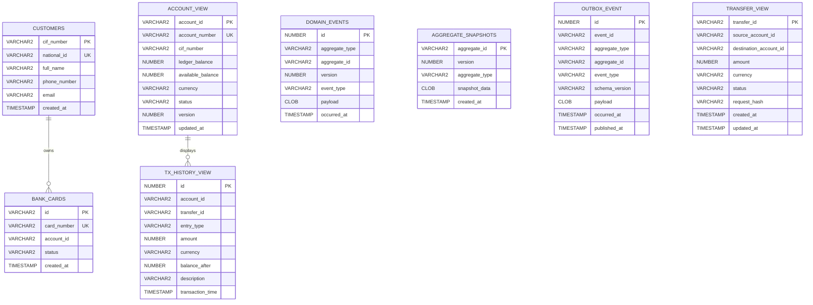
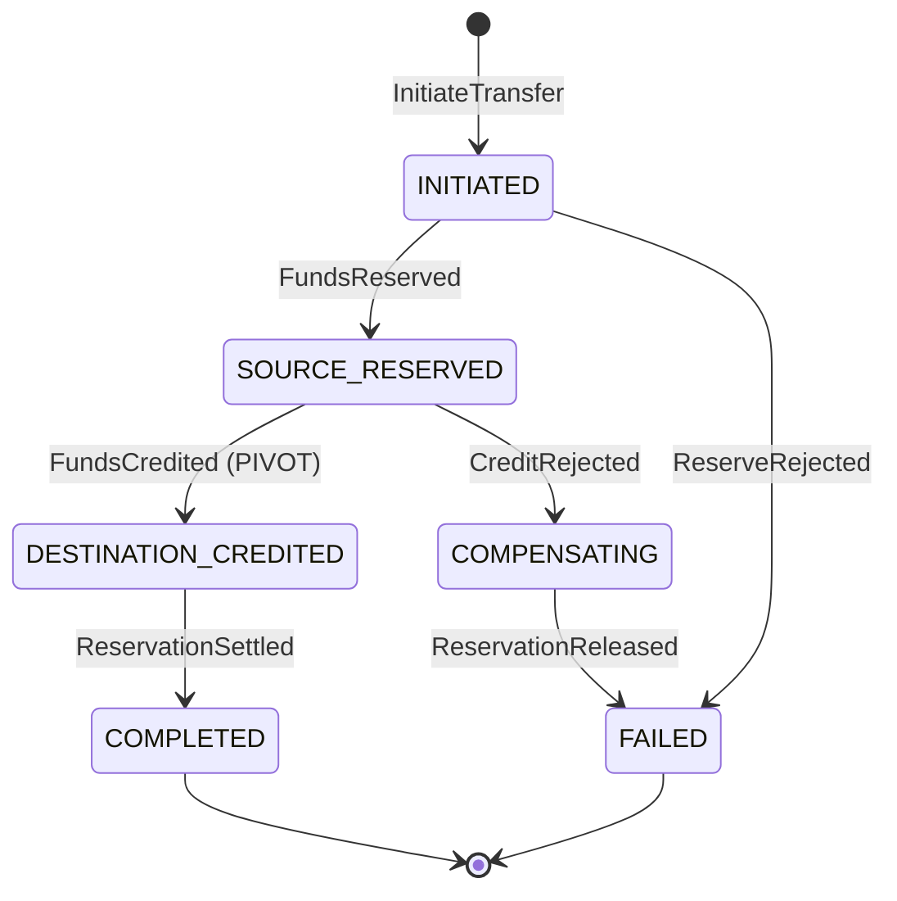
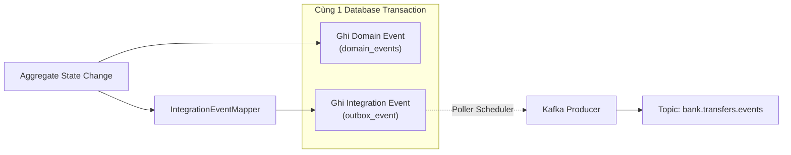

# System Requirements Document (SRD) — Corebank Service
**Dự án:** Simulation Bank Platform  
**Phân hệ:** Sổ cái Ngân hàng Trung tâm (`corebank`)  
**Phiên bản:** 1.1.0  
**Ngày cập nhật:** 2026-10-10  
**Trạng thái:** Chính thức  
**Tham chiếu:** [`brd.md`](./brd.md) (v1.1.0), [`hld.md`](./hld.md) (v1.1.0), [`plan.md`](./plan.md) (v3).

---

## 1. Tổng quan Kỹ thuật & Kiến trúc Hệ thống

### 1.1. Ranh giới & Trách nhiệm Dịch vụ
`corebank` là phân hệ sổ cái ngân hàng trung tâm (Core Ledger Service), là nguồn chân lý duy nhất (Single Source of Truth) lưu trữ số dư tài khoản, hạch toán giao dịch nợ/có và bảo toàn tính toàn vẹn của sổ sách tài chính. Dịch vụ hoạt động hoàn toàn trong dải mạng nội bộ (Internal K8s Service / Private VPC) và không mở cổng trực tiếp ra ngoài Internet.

### 1.2. Tech Stack Cốt lõi
- **Ngôn ngữ & Runtime:** Java 21 LTS, Spring Boot 4.1.0 / Spring Framework 7
- **Serialization:** Jackson 3 (`tools.jackson.*`) tương thích đồng bộ với Boot 4.1.0
- **Kiến trúc:** Domain-Driven Design (DDD), Clean Architecture, CQRS (Command Query Responsibility Segregation), Event Sourcing, Saga Orchestration
- **Cơ sở dữ liệu:** Oracle Database 23c Free / 19c Enterprise (JDBC Thin, HikariCP Connection Pool)
- **Distributed Cache & Lock:** Redis (Spring Data Redis / Lettuce) — L2 RBAC Permission Cache + Atomic Lua In-Flight Idempotency Lock
- **Message Broker:** Apache Kafka 7.5+ kết hợp Transactional Outbox Pattern
- **Bảo mật:** Spring Security, OAuth2 Resource Server, AOP Security (`@CoreBankAuthorization`), Tuân thủ Nghị định 13/2023/NĐ-CP
- **Kiểm thử Kiến trúc & Tự động:** ArchUnit 1.3.0, Testcontainers Oracle, JUnit 5, AssertJ
- **Khả năng quan sát (Observability):** OpenTelemetry Java Agent, Micrometer Metrics & Tracing, Prometheus, Grafana Loki

### 1.3. Cấu trúc Dự án Thực tế (Bounded Contexts Directory Layout)

```text
corebank/src/main/java/com/hieu/corebank/
├── CorebankApplication.java
├── shared/                          # Shared Kernel (Dùng chung 1 chiều)
│   ├── domain/                      # AggregateRoot, DomainEvent, DomainException, BusinessException,
│   │                                # ConflictException, InProgressConflictException,
│   │                                # Money, Currency, NationalId, CardNumber, AccountId, AccountNumber, TransferId
│   ├── application/                 # DomainEventPublisher (port), IntegrationEventPublisher (port), IntegrationEventContributor
│   ├── constant/                    # ProfileConstants (COMMAND, QUERY, ALL)
│   └── infrastructure/
│       ├── eventsourcing/           # EventStore<T>, SnapshotStore, EventSerializer, DomainEventRecord
│       ├── outbox/                  # OutboxRecorder, OutboxIntegrationEventPublisher
│       └── web/                     # BaseController, ApiExceptionHandler, RequestLoggingConfig
├── account/                         # BC: account (Core Subdomain - Sổ cái)
│   ├── domain/                      # AccountAggregate, Hold, HoldStatus, AccountRepository, AccountNumberGenerator
│   │   └── event/                   # AccountCreatedEvent, FundsReservedEvent, FundsCreditedEvent, ...
│   ├── application/
│   │   ├── command/                 # AccountHandler (OpenAccount, Reserve, Credit, Settle, Release)
│   │   ├── query/                   # GetAccountByIdQueryHandler, GetAccountBalanceQueryHandler, GetAccountsByCifQueryHandler
│   │   ├── port/                    # CustomerDirectory, AccountQueryService
│   │   └── event/                   # AccountIntegrationEventContributor
│   ├── infrastructure/
│   │   ├── persistence/             # EventSourcedAccountRepository, SequenceAccountNumberGenerator
│   │   ├── projection/              # AccountProjector, LocalAccountQueryService, AccountView, TransactionHistoryView
│   │   └── customer/                # LocalCustomerDirectory (adapter gọi CustomerRepository)
│   └── api/                         # AccountController(+Impl), DTOs (Request / Response)
├── transfer/                        # BC: transfer (Core Subdomain - Saga Chuyển tiền)
│   ├── domain/                      # Transfer, TransferStatus, TransferRepository
│   │   └── event/                   # TransferInitiatedEvent, TransferCompletedEvent, ...
│   ├── application/
│   │   ├── command/                 # TransferHandler (Idempotency UUID v3, Hash SHA-256, Bounded Latency)
│   │   ├── saga/                    # TransferSaga, SagaRecoveryJob, SagaMetricsCollector
│   │   ├── query/                   # GetTransferByIdQueryHandler, GetTransferHistoryQueryHandler
│   │   ├── port/                    # AccountGateway, TransferIdempotencyLockPort, TransferQueryPort, StuckTransferQueryPort
│   │   └── event/                   # TransferIntegrationEventContributor
│   ├── infrastructure/
│   │   ├── persistence/             # EventSourcedTransferRepository
│   │   ├── idempotency/             # RedisTransferIdempotencyLockAdapter (Atomic Lua In-Flight Lock)
│   │   ├── projection/              # TransferProjector, TransferQueryAdapter, StuckTransferQueryAdapter, TransferView
│   │   ├── account/                 # InProcessAccountGateway, AccountLockManager
│   │   └── config/                  # TransferConfig
│   └── api/                         # TransferController(+Impl), DTOs (TransferRequestDTO, TransferResponseDTO)
├── card/                            # BC: card (Supporting Subdomain - Quản lý Thẻ)
│   ├── domain/                      # BankCard, CardRepository
│   ├── application/
│   │   ├── command/                 # CardHandler (IssueCard)
│   │   ├── query/                   # GetCardByIdQueryHandler, GetCardsByCifQueryHandler
│   │   └── port/                    # AccountDirectory
│   ├── infrastructure/
│   │   ├── persistence/             # CardEntity (JPA), CardJpaRepository, JpaCardRepositoryAdapter
│   │   └── account/                 # LocalAccountDirectory (adapter gọi AccountQueryService)
│   └── api/                         # CardController(+Impl), DTOs (PAN Masking, Zero CVV)
├── customer/                        # BC: customer (Supporting Subdomain - Quản lý CIF)
│   ├── domain/                      # Customer, CustomerRepository, CifGenerator
│   ├── application/
│   │   ├── command/                 # CustomerHandler (CreateCustomer)
│   │   └── query/                   # GetCustomerQueryHandler
│   ├── infrastructure/
│   │   └── persistence/             # CustomerEntity (JPA), CustomerJpaRepository, JpaCustomerRepositoryAdapter, SequenceCifGenerator
│   └── api/                         # CustomerController(+Impl), DTOs (CCCD Masking)
└── access/                          # BC: access (Generic Subdomain - Phân quyền Nội bộ)
    ├── infrastructure/
    │   └── persistence/             # RoleEntity, PermissionEntity, UserEntity, JpaRepositories
    └── security/                    # @CoreBankAuthorization, CoreBankAuthorizationAspect, PermissionCacheService

---

### 1.4. Bảng Ánh xạ Phân tầng Clean Architecture & DDD (CA/DDD Package Mapping)

Mọi package trong hệ thống đều tương ứng chính xác với một tầng trong Clean Architecture và tuân thủ các quy tắc ràng buộc nghiêm ngặt:

| Tầng CA / DDD | Package Cấu trúc | Thành phần Mã nguồn Điển hình | Trách nhiệm Nghiệp vụ / Kỹ thuật | Quy tắc Ràng buộc (ArchUnit Rules) |
|---|---|---|---|---|
| **Domain** | `com.hieu.corebank.<bc>.domain`<br/>`com.hieu.corebank.shared.domain` | `AccountAggregate`, `Transfer`, `Customer`, `Hold`, `Money`, `Currency`, `NationalId`, `CardNumber` | Nắm giữ Invariants nghiệp vụ, logic thay đổi trạng thái, phương trình kế toán kép. | **Thuần khiết 100% POJO**. Cấm phụ thuộc Spring, JPA, Jackson (`rule1`, `rule1a-c`). |
| **Application** | `com.hieu.corebank.<bc>.application`<br/>(command, query, saga, port) | `AccountHandler`, `TransferHandler`, `TransferSaga`, `SagaRecoveryJob`, `AccountGateway` | Thực thi Use Cases, điều phối quy trình Saga, kiểm tra Cấp 2 (Stateful/Idempotency), định nghĩa Ports. | **Độc lập Hạ tầng**. Không phụ thuộc `infrastructure` hay `api` Controllers (`rule2`). |
| **Infrastructure** | `com.hieu.corebank.<bc>.infrastructure`<br/>(persistence, projection, adapters) | `EventSourcedAccountRepository`, `AccountProjector`, `InProcessAccountGateway`, `EventStore<T>` | Hiện thực Ports (DIP), tương tác DB Oracle, quản lý Event Store, Snapshot, Kafka Outbox, Projectors. | Repositories/Adapters chỉ nằm trong `infrastructure`/`persistence` (`rule5`). |
| **API / Presentation** | `com.hieu.corebank.<bc>.api`<br/>(dto, impl) | `AccountControllerImpl`, `TransferControllerImpl`, `ApiExceptionHandler`, Request/Response DTOs | Inbound REST endpoints, chuyển đổi DTO sang Command, đón và chuẩn hóa HTTP Response, che mờ PII. | Toàn bộ `@RestController` chỉ được phép nằm trong package `..api..` (`rule4`). |
| **Shared Kernel** | `com.hieu.corebank.shared` | `AggregateRoot<ID>`, `DomainEvent`, `Money`, `Currency`, `EventStore`, `ProfileConstants` | Cung cấp kiểu dữ liệu và hạ tầng dùng chung cho toàn bộ các Bounded Context. | **Phụ thuộc 1 chiều**. Tuyệt đối không import bất kỳ Bounded Context con nào (`rule6`). |

---

### 1.5. Ma trận Phụ thuộc giữa các Tầng & Bounded Contexts (Dependency Matrix)

Bảng ma trận thể hiện tính hợp lệ của quan hệ phụ thuộc giữa các package trong mã nguồn (được kiểm chứng tự động bởi `ArchitectureFitnessArchUnitTest`):

| Package Gọi \ Package Được Gọi | `shared.domain` | `<bc>.domain` | `<bc>.application` | `<bc>.infrastructure` | `<bc>.api` | Khác BC Context |
|---|:---:|:---:|:---:|:---:|:---:|:---:|
| **`shared.domain`** | — | ❌ CẤM | ❌ CẤM | ❌ CẤM | ❌ CẤM | ❌ CẤM (`rule6`) |
| **`shared.infrastructure`** | ✅ HỢP LỆ | ❌ CẤM | ❌ CẤM | — | ❌ CẤM | ❌ CẤM (`rule6`) |
| **`<bc>.domain`** | ✅ HỢP LỆ | — | ❌ CẤM | ❌ CẤM | ❌ CẤM | ❌ CẤM (`rule1`) |
| **`<bc>.application`** | ✅ HỢP LỆ | ✅ HỢP LỆ | — | ❌ CẤM (`rule2`) | ❌ CẤM (`rule2`) | ❌ CẤM |
| **`<bc>.infrastructure`** | ✅ HỢP LỆ | ✅ HỢP LỆ | ✅ HỢP LỆ (Port) | — | ❌ CẤM | ❌ CẤM (`rule3`, `rule3b`, `rule3c`) |
| **`<bc>.api`** | ✅ HỢP LỆ | ❌ HẠN CHẾ | ✅ HỢP LỆ (Use Case) | ❌ CẤM | — | ❌ CẤM |
| **Liên Bounded Context** | ✅ HỢP LỆ | ❌ CẤM (`rule3b`) | ✅ Qua Port/Adapter | ❌ CẤM (`rule3`, `rule3b`) | ❌ CẤM | — |

*Ghi chú:*
- Giao tiếp giữa 2 Bounded Context bất kỳ (ví dụ `transfer` gọi `account`): Bắt buộc thông qua Outbound Port tại `transfer.application.port.AccountGateway` $\rightarrow$ Adapter `transfer.infrastructure.account.InProcessAccountGateway` $\rightarrow$ gọi tới `account.application.command.AccountHandler`. Cấm gọi trực tiếp giữa 2 tầng `domain` hoặc giữa 2 tầng `infrastructure`.

---

### 1.6. Danh mục Kiểm thử Ràng buộc Kiến trúc (ArchUnit Rules Reference)

Bộ bài kiểm thử `ArchitectureFitnessArchUnitTest` mã hóa 100% các nguyên tắc kiến trúc thành assertions tự động trong CI/CD:

1. **`rule1_domainMustBePure`**: Quét toàn bộ package `..domain..` (ngoại trừ các record kết thúc bằng `Record`), đảm bảo không phụ thuộc vào `org.springframework..`, `jakarta.persistence..`, `tools.jackson..`, `com.fasterxml.jackson..`.
2. **`rule1a_accountDomainMustBePureStrict`**, **`rule1b_sharedDomainMustBePureStrict`**, **`rule1c_transferDomainMustBePureStrict`**: Kiểm tra nghiêm ngặt tính thuần khiết 100% của các package domain cốt lõi.
3. **`rule2_applicationShouldNotDependOnInfrastructureOrApi`**: Tầng `application` không được import `infrastructure` hay `api` (ngoại trừ DTOs phục vụ Request/Response).
4. **`rule3_noDirectCrossBcInfrastructureCoupling`**: Context `account` không được phụ thuộc trực tiếp vào `customer.infrastructure` hay `card.infrastructure`.
5. **`rule3b_transferDoesNotDependOnAccountDomainOrInfrastructureStrict`**: Context `transfer` không được phụ thuộc vào `account.domain` hay `account.infrastructure`.
6. **`rule3c_cardDoesNotDependOnAccountDomainOrInfrastructureStrict`**: Context `card` không được phụ thuộc vào `account.domain` hay `account.infrastructure`.
7. **`rule4_controllersMustResideInApiPackage`**: Toàn bộ class mang annotation `@RestController` bắt buộc phải nằm trong package `..api..`.
8. **`rule5_repositoriesMustResideInInfrastructure`**: Mọi interface kết thúc bằng `Repository` phải nằm trong `infrastructure`, `persistence` hoặc `domain` port.
9. **`rule6_sharedKernelMustNotDependOnBoundedContextsStrict`**: Package `shared` không được phụ thuộc vào bất kỳ Bounded Context cụ thể nào (`account`, `transfer`, `card`, `customer`, `access`).

---

## 2. Thiết kế Cơ sở Dữ liệu (Database Schema / ERD)

### 2.1. Sơ đồ Quan hệ Thực thể (ERD Chuẩn hóa v1.1.0)

Hệ thống đã loại bỏ hoàn toàn các bảng legacy V1 (`accounts`, `bank_transactions`) để chuyển sang kiến trúc Event Sourcing kết hợp CQRS:



---

### 2.2. Đặc tả Bảng Chi tiết

#### Bảng `domain_events` (Master Event Store)
| Cột | Kiểu dữ liệu | Ràng buộc | Mô tả |
|---|---|---|---|
| `id` | `NUMBER GENERATED BY DEFAULT AS IDENTITY` | `PRIMARY KEY` | Khóa chính tự tăng kỹ thuật |
| `aggregate_type` | `VARCHAR2(64)` | `NOT NULL` | Định danh kiểu Aggregate: `Account`, `Transfer` |
| `aggregate_id` | `VARCHAR2(64)` | `NOT NULL` | ID Aggregate: `accountId`, `transferId` |
| `version` | `NUMBER(19)` | `NOT NULL` | Phiên bản sự kiện tuần tự tăng dần (1, 2, 3...) |
| `event_type` | `VARCHAR2(128)` | `NOT NULL` | Tên sự kiện: `AccountOpened`, `FundsReserved`, `FundsCredited`, `ReservationSettled`... |
| `payload` | `CLOB` | `NOT NULL` | Dữ liệu sự kiện JSON |
| `occurred_at` | `TIMESTAMP WITH TIME ZONE` | `NOT NULL` | Thời điểm phát sinh sự kiện |

*Index & Ràng buộc Bắt buộc:*
```sql
CONSTRAINT uk_domain_events_version UNIQUE (aggregate_id, version);
CREATE INDEX ix_domain_events_type_time ON domain_events (aggregate_type, occurred_at);
```

#### Bảng `aggregate_snapshots` (Snapshot Store)
| Cột | Kiểu dữ liệu | Ràng buộc | Mô tả |
|---|---|---|---|
| `aggregate_id` | `VARCHAR2(64)` | `PRIMARY KEY` | ID của Aggregate Root |
| `version` | `NUMBER(19)` | `NOT NULL` | Phiên bản Aggregate tại thời điểm chụp snapshot |
| `aggregate_type` | `VARCHAR2(64)` | `NOT NULL` | Kiểu Aggregate |
| `snapshot_data` | `CLOB` | `NOT NULL` | Trạng thái đầy đủ 100% của Aggregate (JSON) bao gồm cả `holds` |
| `created_at` | `TIMESTAMP WITH TIME ZONE` | `NOT NULL` | Thời điểm tạo snapshot |

#### Bảng `transfer_view` (Read Model & Saga Recovery View)
| Cột | Kiểu dữ liệu | Ràng buộc | Mô tả |
|---|---|---|---|
| `transfer_id` | `VARCHAR2(64)` | `PRIMARY KEY` | Sinh tất định: `UUID v3(sourceAccountId + ":" + idempotencyKey)` |
| `source_account_id` | `VARCHAR2(64)` | `NOT NULL` | ID tài khoản chuyển |
| `destination_account_id`| `VARCHAR2(64)` | `NOT NULL` | ID tài khoản nhận |
| `amount` | `NUMBER(18,2)` | `NOT NULL` | Số tiền giao dịch |
| `currency` | `VARCHAR2(3)` | `NOT NULL` | Loại tiền tệ ISO 4217 |
| `status` | `VARCHAR2(32)` | `NOT NULL` | `INITIATED`, `PENDING`, `COMPLETED`, `FAILED` |
| `request_hash` | `VARCHAR2(64)` | `NOT NULL` | Mã băm SHA-256 payload để phát hiện 409 Conflict |
| `created_at` | `TIMESTAMP WITH TIME ZONE` | `NOT NULL` | Thời điểm tạo lệnh |
| `updated_at` | `TIMESTAMP WITH TIME ZONE` | `NOT NULL` | Dùng cho `SagaRecoveryJob` quét timeout |

*Index Bắt buộc phục vụ Self-Healing Worker:*
```sql
CREATE INDEX ix_transfer_recovery ON transfer_view (status, updated_at);
```

#### Bảng `customers` (Customer Directory)
| Cột | Kiểu dữ liệu | Ràng buộc | Mô tả |
|---|---|---|---|
| `cif_number` | `VARCHAR2(20)` | `PRIMARY KEY` | Mã CIF chuẩn 8 chữ số (`00000001` - `99999999`) |
| `national_id` | `VARCHAR2(20)` | `NOT NULL, UNIQUE` | Số CCCD/Hộ chiếu (Chống trùng Cấp 4) |
| `full_name` | `VARCHAR2(100)` | `NOT NULL` | Họ và tên khách hàng |
| `phone_number` | `VARCHAR2(20)` | `NOT NULL` | Số điện thoại liên hệ |
| `email` | `VARCHAR2(100)` | `NOT NULL` | Email khách hàng |
| `created_at` | `TIMESTAMP WITH TIME ZONE` | `NOT NULL` | Thời điểm tạo hồ sơ |

*Index & Ràng buộc:*
```sql
CONSTRAINT uk_customer_national_id UNIQUE (national_id);
```

#### Bảng `bank_cards` (Card Registry)
| Cột | Kiểu dữ liệu | Ràng buộc | Mô tả |
|---|---|---|---|
| `id` | `VARCHAR2(36)` | `PRIMARY KEY` | UUID thẻ ngân hàng |
| `card_number` | `VARCHAR2(16)` | `NOT NULL, UNIQUE` | Số thẻ 16 chữ số chuẩn BIN + Luhn |
| `account_id` | `VARCHAR2(64)` | `NOT NULL` | Tham chiếu ID tài khoản thanh toán |
| `status` | `VARCHAR2(20)` | `NOT NULL` | `ACTIVE`, `BLOCKED`, `EXPIRED` |
| `created_at` | `TIMESTAMP WITH TIME ZONE` | `NOT NULL` | Thời điểm phát hành |

*Lưu ý bảo mật NĐ 13/2023:* Bảng `bank_cards` **tuyệt đối KHÔNG có cột `cvv` plaintext**. Corebank không lưu trữ mã CVV sau khi phát hành.

#### Bảng `outbox_event` (Transactional Outbox)
| Cột | Kiểu dữ liệu | Ràng buộc | Mô tả |
|---|---|---|---|
| `id` | `NUMBER GENERATED BY DEFAULT AS IDENTITY` | `PRIMARY KEY` | ID tự tăng |
| `event_id` | `VARCHAR2(64)` | `NOT NULL` | UUID của sự kiện |
| `aggregate_type` | `VARCHAR2(64)` | `NOT NULL` | Kiểu aggregate |
| `aggregate_id` | `VARCHAR2(64)` | `NOT NULL` | ID aggregate |
| `event_type` | `VARCHAR2(128)` | `NOT NULL` | Tên Integration Event (`TransferCompletedEventDTO`) |
| `schema_version` | `VARCHAR2(16)` | `NOT NULL` | Phiên bản hợp đồng event: `1.0` |
| `payload` | `CLOB` | `NOT NULL` | Payload chuẩn hóa JSON |
| `occurred_at` | `TIMESTAMP WITH TIME ZONE` | `NOT NULL` | Thời điểm phát sinh |
| `published_at` | `TIMESTAMP WITH TIME ZONE` | `NULL` | Thời điểm đã bắn sang Kafka |

---

## 3. Đặc tả Giao tiếp API (Internal REST API Specifications)

Toàn bộ API giao tiếp qua mạng nội bộ (`http://corebank-command:8180` hoặc `http://corebank-query:8180`).
- **Base Path:** `/api/v1`
- **Standard Headers:**
  - `Content-Type: application/json`
  - `X-Correlation-Id: <UUID>` (Distributed Tracing)
  - `Idempotency-Key: <String>` (Bắt buộc cho mọi lệnh Command ghi)

---

### 3.1. Nhóm Quản lý Khách hàng (`CustomerController`)

#### POST `/api/v1/customers`
Tạo hồ sơ khách hàng mới, sinh mã CIF 8 số tự động và kiểm tra tính duy nhất của CCCD.
- **Request Body:**
  ```json
  {
    "fullName": "NGUYEN VAN A",
    "nationalId": "012345678901",
    "phoneNumber": "0987654321",
    "email": "nguyenvana@example.com"
  }
  ```
- **Response 201 Created (Che mờ CCCD tuân thủ NĐ 13/2023):**
  ```json
  {
    "cifNumber": "00012345",
    "fullName": "NGUYEN VAN A",
    "nationalId": "012345****01",
    "phoneNumber": "0987654321",
    "email": "nguyenvana@example.com",
    "createdAt": "2026-10-10T10:15:30Z"
  }
  ```
- **Error Response 409 Conflict (Trùng CCCD):**
  ```json
  {
    "status": 409,
    "errorCode": "CUSTOMER_ALREADY_EXISTS",
    "message": "Số CCCD/Hộ chiếu đã được đăng ký trong hệ thống",
    "timestamp": "2026-10-10T10:15:30Z"
  }
  ```

#### GET `/api/v1/customers/{cif}`
Tra cứu thông tin khách hàng qua CIF. Trả về thông tin kèm CCCD đã mask.

---

### 3.2. Nhóm Quản lý Tài khoản (`AccountController`)

#### POST `/api/v1/accounts`
Mở tài khoản thanh toán mới liên kết CIF.
- **Request Body:**
  ```json
  {
    "cifNumber": "00012345",
    "currency": "VND",
    "initialDeposit": 1000000
  }
  ```
- **Response 201 Created:**
  ```json
  {
    "accountId": "acc-7f8e-4a12",
    "accountNumber": "100200300401",
    "cifNumber": "00012345",
    "ledgerBalance": 1000000,
    "availableBalance": 1000000,
    "currency": "VND",
    "status": "ACTIVE",
    "createdAt": "2026-10-10T10:16:00Z"
  }
  ```

#### GET `/api/v1/accounts/{accountId}/balance`
Truy vấn số dư tức thời.
- **Response 200 OK:**
  ```json
  {
    "accountId": "acc-7f8e-4a12",
    "accountNumber": "100200300401",
    "currency": "VND",
    "actualBalance": 1000000,
    "availableBalance": 800000,
    "holdBalance": 200000,
    "status": "ACTIVE"
  }
  ```

---

### 3.3. Nhóm Quản lý Thẻ (`CardController` & `AccountController`)

#### `POST /api/v1/cards` hoặc `POST /api/v1/accounts/{accountId}/cards`
Phát hành thẻ thanh toán liên kết tài khoản.
- **Request Body (`POST /api/v1/cards`):**
  ```json
  {
    "accountId": "acc-7f8e-4a12"
  }
  ```
  *(Với `POST /api/v1/accounts/{accountId}/cards`, `accountId` lấy trực tiếp từ PathVariable).*
- **Response 200/201 Created (Che mờ PAN, tuyệt đối KHÔNG lưu và KHÔNG trả về CVV):**
  ```json
  {
    "cardId": "crd-9a1b-3c4d",
    "maskedCardNumber": "4111-22XX-XXXX-3344",
    "accountId": "acc-7f8e-4a12",
    "cifNumber": "00012345",
    "status": "ACTIVE",
    "createdAt": "2026-10-10T10:17:00Z"
  }
  ```

---

### 3.4. Nhóm Chuyển tiền & Sổ cái (`TransferController`)

#### POST `/api/v1/transfers`
Tiếp nhận lệnh chuyển tiền nội bộ qua Saga. Hỗ trợ Idempotency tất định và Bounded Latency.
- **Headers:**
  - `Content-Type: application/json`
  - `X-Correlation-Id: <UUID>` (Distributed Tracing)
  - `Idempotency-Key: <String>` (Tuỳ chọn đồng bộ ở tầng Gateway; `TransferRequestDTO.idempotencyKey` trong body là nguồn chân lý)
- **Request Body:**
  ```json
  {
    "sourceAccountId": "acc-7f8e-4a12",
    "destinationAccountId": "acc-3b2a-9f81",
    "amount": 250000,
    "currency": "VND",
    "idempotencyKey": "9b1deb4d-3b7d-4bad-9bdd-2b0d7b3dcb6d",
    "description": "Thanh toan tien an trua"
  }
  ```

- **Kịch bản 1: Hoàn tất trong thời hạn SLA ($\le 3\text{s}$) $\rightarrow$ Response 200 OK:**
  ```json
  {
    "transactionId": "d3b07384-d113-3920-a193-cc449be9d4a4",
    "status": "SUCCESS",
    "sourceAccountId": "acc-7f8e-4a12",
    "destinationAccountId": "acc-3b2a-9f81",
    "amount": 250000,
    "currency": "VND",
    "description": "Thanh toan tien an trua",
    "createdAt": "2026-10-10T10:18:00Z"
  }
  ```
  *(Lưu ý: Response tuyệt đối không phơi bày số dư người nhận để tuân thủ Data Minimization - [NFR-CB-20](./brd.md#L246); DTO map trạng thái `COMPLETED` của Aggregate thành `SUCCESS`).*

- **Kịch bản 2: Quá thời hạn timeout $N$ giây $\rightarrow$ Response HTTP 200/202 kèm `status=PENDING` (Async Fallback):**
  ```json
  {
    "transactionId": "d3b07384-d113-3920-a193-cc449be9d4a4",
    "status": "PENDING",
    "sourceAccountId": "acc-7f8e-4a12",
    "destinationAccountId": "acc-3b2a-9f81",
    "amount": 250000,
    "currency": "VND",
    "description": "Thanh toan tien an trua",
    "createdAt": "2026-10-10T10:18:00Z"
  }
  ```
  *(Giải phóng kết nối cho client không bị treo; Saga tiếp tục hoàn tất ngầm trong nền và đẩy kết quả sang Kafka).*

- **Kịch bản 3a: Gửi lại cùng `idempotencyKey` nhưng sai lệch payload $\rightarrow$ Response 409 Conflict (`409001`):**
  ```json
  {
    "code": "409001",
    "message": "Idempotency key conflict: request payload differs from previous request",
    "correlationId": "corr-9b1d-3b7d",
    "details": []
  }
  ```

- **Kịch bản 3b: Nhiều Pod nhận đồng thời cùng `idempotencyKey` (khớp payload) khi giao dịch đang xử lý (`IN_FLIGHT`) $\rightarrow$ Response 409 Conflict (`409002`):**
  ```json
  {
    "code": "409002",
    "message": "Transfer with this idempotency key is currently being processed",
    "correlationId": "corr-9b1d-3b7d",
    "details": []
  }
  ```
  *(Giúp `money-bank` phân biệt rõ giao dịch đang thực thi dở dang với lỗi gian lận/sai lệch payload `409001`; khóa Redis được xóa tự động ngay khi luồng Saga kết thúc).*

- **Kịch bản 4: Thiếu số dư hoặc Tài khoản bị khóa $\rightarrow$ Response 422 Unprocessable Entity:**
  ```json
  {
    "status": 422,
    "errorCode": "INSUFFICIENT_FUNDS",
    "message": "Số dư khả dụng không đủ để thực hiện giao dịch",
    "timestamp": "2026-10-10T10:18:00Z"
  }
  ```

---

## 4. Kiểm soát Xử lý Đồng thời, Idempotency & Tự phục hồi Saga

### 4.1. Thực thi Chiến lược Thẩm định 4 Cấp độ trong Mã nguồn
1. **Cấp 1 (Value Object):**
   ```java
   Money amount = Money.of(request.getAmount(), Currency.of(request.getCurrency()));
   AccountId source = AccountId.of(request.getSourceAccountId());
   ```
   Nếu `amount <= 0` hoặc sai currency format $\rightarrow$ Ném `IllegalArgumentException` ngay lập tức trên RAM.
2. **Cấp 2 (Use Case / Application Service):**
   - Tính toán tất định:
     ```java
     String transferId = UUID.nameUUIDFromBytes((request.getSourceAccountId() + ":" + request.getIdempotencyKey()).getBytes(UTF_8)).toString();
     String requestHash = computeRequestHash(request);
     ```
   - Tra cứu nhanh trong `transfer_view` (qua `TransferQueryPort`):
     - Nếu đã có nhưng khác `requestHash` $\rightarrow$ Ném ngoại lệ `ConflictException` (`HTTP 409` — mã `409001`).
     - Nếu đã ở trạng thái kết thúc (`COMPLETED` / `FAILED`) và khớp `requestHash` $\rightarrow$ Replay kết quả ngay trong $\le 50\text{ ms}$ (0 Redis hops).
   - Cấp khóa phân tán In-Flight trên Redis qua `TransferIdempotencyLockPort` (`RedisTransferIdempotencyLockAdapter`):
     - Atomic Lua Script đặt `idem:transfer:lock:{transferId}` = `{lockToken}:{requestHash}` với TTL cầu chì `30s` (`corebank.transfer.idempotency-lock-ttl-seconds: 30`).
     - Nếu đang bị Pod khác giữ khóa: lệch `requestHash` $\rightarrow$ `409001`; khớp `requestHash` $\rightarrow$ Ném `InProgressConflictException` (`HTTP 409` — mã `409002`).
     - Nếu Redis mất kết nối $\rightarrow$ Tự động fallback an toàn xuống chốt chặn Database.
     - Ngay khi luồng thực thi `TransferSaga` kết thúc (kể cả khi quá `sync-timeout` chuyển sang chạy ngầm), Lua Script đối chiếu `lockToken` và xóa khóa ngay lập tức (`TTL = 0` sau khi xong, không tồn đọng RAM).
3. **Cấp 3 (Aggregate Root Invariant):**
   - `Account.reserve(transferId, amount)`: Kiểm tra `status == ACTIVE`, `availableBalance >= amount`. Nếu đã có `Hold` cùng `transferId` $\rightarrow$ no-op (idempotent).
   - `Account.credit(transferId, amount)`: Nếu `creditedTransfers` đã có `transferId` $\rightarrow$ no-op.
   - `Account.settle(transferId)`: Nếu `Hold` đã ở trạng thái `SETTLED` $\rightarrow$ no-op.
4. **Cấp 4 (Database Constraint):**
   - Khi có 50 request bắn đồng thời vào cùng một tài khoản ([AC-CB-03](./brd.md#L275)): `CONSTRAINT uk_domain_events_version UNIQUE (aggregate_id, version)` sẽ bảo đảm chỉ 1 transaction commit thành công. 49 transaction còn lại nhận `DataIntegrityViolationException` và được hệ thống retry với backoff an toàn.

---

### 4.2. Saga Orchestration & Cơ chế Tự phục hồi (`SagaRecoveryJob`)



- **Quy tắc Pivot:** Bước `FundsCredited` là Pivot Transaction. Sau bước này, hệ thống cấm tuyệt đối quay lui bù trừ. Bước `settle` tài khoản nguồn bắt buộc forward retry vô hạn cho đến khi thành công.
- **Tiến trình Self-Healing (`SagaRecoveryJob`):**
  - Chạy định kỳ mỗi 10 giây trên cụm `corebank-command`.
  - Quét các transaction bị treo quá 30 giây:
    ```sql
    SELECT * FROM transfer_view 
    WHERE status NOT IN ('COMPLETED', 'FAILED') 
      AND updated_at < SYSTIMESTAMP - INTERVAL '30' SECOND 
    FOR UPDATE SKIP LOCKED;
    ```
  - Từ trạng thái hiện tại trong `transfer_view`, Job phát lại bước tiếp theo tương ứng. Nhờ tính idempotent của các lệnh Aggregate, việc recovery luôn bảo đảm an toàn 100%, không bao giờ thất thoát tiền ([AC-CB-06](./brd.md#L278)).

---

## 5. Transactional Outbox & Tách biệt Domain vs Integration Events



- **Hợp đồng Integration Event (`bank.transfers.events`):**
  ```json
  {
    "eventId": "evt-8f2a-4c11",
    "eventType": "TransferCompletedEvent",
    "schemaVersion": "1.0",
    "occurredAt": "2026-10-10T10:18:00Z",
    "payload": {
      "transferId": "d3b07384-d113-3920-a193-cc449be9d4a4",
      "sourceAccountId": "acc-7f8e-4a12",
      "destinationAccountId": "acc-3b2a-9f81",
      "amount": 250000,
      "currency": "VND",
      "status": "COMPLETED"
    }
  }
  ```

---

## 6. Khả năng Quan sát, Vòng đời K8s & Triển khai CQRS

### 6.1. Saga Observability & Metrics (Micrometer / Prometheus)
Hệ thống xuất bản các số liệu đo lường chuyên biệt:
- `corebank_saga_step_total{step="RESERVE|CREDIT|SETTLE|RELEASE", status="SUCCESS|FAILED"}`: Đo lường lưu lượng và tỷ lệ thành công của từng bước Saga.
- `corebank_saga_stuck_total`: Số lượng giao dịch bị kẹt quá thời gian $T_{\text{stuck}}$.
- `corebank_concurrency_retries_total`: Số lần retry do xung đột version Optimistic Lock.
- **Alerting Rule:** Kích hoạt cảnh báo PagerDuty/Slack tức thì khi `corebank_saga_stuck_total > 0`.

### 6.2. Container Lifecycle & Graceful Shutdown
- Cấu hình trong `application.yaml`:
  ```yaml
  server:
    shutdown: graceful
  spring:
    lifecycle:
      timeout-per-shutdown-phase: 30s
  ```
- Khi nhận tín hiệu `SIGTERM` từ Kubernetes:
  1. Dừng tiếp nhận request mới tại HTTP Server.
  2. Cho phép các transaction và bước saga đang chạy dở dang hoàn tất trong tối đa 30 giây.
  3. Đóng và giải phóng HikariCP connection pool an toàn trước khi container bị dừng.
- Cấu hình JVM tối ưu container:
  ```dockerfile
  ENV SPRING_PROFILES_ACTIVE=all
  ENV JAVA_OPTS="-XX:+UseContainerSupport -XX:MaxRAMPercentage=75.0"
  ENTRYPOINT ["sh", "-c", "exec java $JAVA_OPTS -jar /app/app.jar"]
  ```

### 6.3. Mô hình Triển khai K8s Command / Query (CQRS)
- **Cụm `corebank-command`:**
  - Deployment 2 Pods cố định (bảo vệ connection pool của Primary Master DB).
  - Kết nối: `spring.datasource.url=${DB_WRITE_URL}`.
  - Profile: `SPRING_PROFILES_ACTIVE=command`.
- **Cụm `corebank-query`:**
  - Deployment tích hợp HPA (co giãn tự động từ 3 đến 20 Pods dựa trên CPU $\ge 70\%$).
  - Kết nối: `spring.datasource.url=${DB_READ_URL}`.
  - Profile: `SPRING_PROFILES_ACTIVE=query`.
  - Phục vụ tải đọc 5,000 QPS sao kê/số dư mà không ảnh hưởng tới P95 của luồng ghi ([AC-CB-08](./brd.md#L280)).
